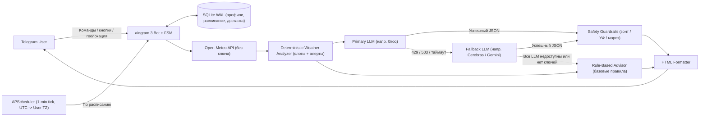

# 🌦 Weather Wardrobe Bot — Погодный гардеробщик

Персональный Telegram-бот, который в нужные дни и часы присылает прогноз погоды в человеческом виде: предупреждает о дожде, ветре и перепадах температуры и подсказывает, **что именно надеть сегодня** (включая вещи из вашего реального шкафа).

Проект спроектирован для **полностью бесплатного 24/7 хостинга на Oracle Cloud Free Tier** (ARM64 Ampere A1 и AMD64) с минималистичным Docker-стеком и гибридной **Deterministic + AI** архитектурой.

---

## ✨ Возможности

- **Компактный mobile-first интерфейс:** минимум лишнего текста и 3 главные кнопки (`🌤 Сегодня`, `📅 Завтра`, `⚙️ Настройки`).
- **Анализ маршрута (`🚶 Маршрут`):** задайте Точку Б (офис, учёба, район), дни недели, время выхода/возвращения и способ (пешком, велосипед, транспорт, авто). Бот проверит погоду по дороге туда, днём в точке назначения и обратно (велосипедистам при дожде советует дождевик, а не зонт).
- **Настройка расписания прямо в чате:** для каждого из 7 дней недели можно задать своё время отправки (пресеты или произвольное `ЧЧ:ММ`) либо выключить уведомление в конкретные дни.
- **Умный выбор локации:** поиск города/района по названию (Open-Meteo + Nominatim) с автоматическим IANA-часовым поясом или отправка Telegram-геопозиции.
- **Персональный термокомфорт и гардероб:** поправка от `-5°C` до `+5°C` (+ быстрые кнопки под прогнозом), свой список курток/обуви и ответы ИИ на свободные вопросы в чате.

---

## 🏗 Архитектура



### Зачем здесь ИИ и где работают обычные алгоритмы

На практике ИИ нужно внедрять не везде подряд, а только туда, где жёсткие `if/else` правила проигрывают по гибкости:

| Задача | Что используется | Почему именно так |
| --- | --- | --- |
| Таймзоны, расписание, защита от повторной отправки | **Обычный алгоритм + SQLite** | Должно работать со 100% точностью и идемпотентностью (`PRIMARY KEY` в `delivery_logs`). |
| Агрегация погоды за активное окно (`08:00–21:00`), интервалы дождя (`14:00–17:00`), порывы ветра, перепад температур | **Детерминированная математика** | LLM не должны считать средние значения и сравнивать числа — надёжнее и быстрее посчитать в Python. |
| Жёсткие правила безопасности (взять зонт при вероятности дождя ≥ 45%, УФ-защита, шапка/перчатки в мороз) | **Детерминированные Guardrails** | Даже если нейросеть забудет упомянуть зонт, пост-валидация (`_enforce_safety_invariants`) гарантированно вернёт его в ответ. |
| Разбор произвольного текста гардероба (*«замшевые ботинки, тонкий тренч»*) и отсев неподходящих материалов в дождь | **ИИ (LLM, JSON Structured Output)** | Неструктурированный текст невозможно надёжно разобрать регулярками — языковая модель понимает материалы и сочетаемость вещей. |
| Ответы на свободные вопросы (*«Успею дойти без зонта до 18:00?»*) | **ИИ (LLM)** | Генерация естественного контекстного ответа поверх точного прогноза. |
| Отказоустойчивость (если API нейросети упал, превысил лимит или не настроен) | **Каскад `Primary LLM → Fallback LLM → RuleBasedAdvisor`** | Бот автоматически переключается на резервного провайдера (например, с Groq на Cerebras) или на метео-правила без сбоев доставки. |

---

## 🤖 Подключение бесплатного ИИ с авто-резервом (опционально)

Бот работает по стандартному **OpenAI-compatible Chat Completions API** через лёгкий `httpx` без тяжёлых SDK и поддерживает **цепочку из двух провайдеров** (`Primary → Fallback → Правила`). Если оставить оба ключа пустыми, бот работает полностью на детерминированных метео-правилах.

| Провайдер | Бесплатный лимит и плюсы | Настройки для `.env` |
| --- | --- | --- |
| **Groq** (рекомендуется как Primary) | 30 RPM / 1 000 RPD / до 200K–500K токенов/день, без карты, выделенные лимиты на аккаунт | `LLM_BASE_URL=https://api.groq.com/openai/v1`<br>`LLM_MODEL=llama-3.3-70b-versatile` |
| **Cerebras** (отличный Fallback / Primary) | ~1 000 000 токенов в день бесплатно без карты, рекордная скорость инференса | `LLM_FALLBACK_BASE_URL=https://api.cerebras.ai/v1`<br>`LLM_FALLBACK_MODEL=gpt-oss-120b` |
| **Google AI Studio (Gemini)** | Бесплатный Free Tier по API-ключу (иногда бывает 503 при пиках нагрузки — удобно ставить как Fallback) | `LLM_FALLBACK_BASE_URL=https://generativelanguage.googleapis.com/v1beta/openai/`<br>`LLM_FALLBACK_MODEL=gemini-4-hydrogen` |
| **OpenRouter (`:free`)** | Агрегатор 20+ бесплатных моделей (50 RPD бесплатно, 1 000 RPD при разовом пополнении $10) | `LLM_FALLBACK_BASE_URL=https://openrouter.ai/api/v1`<br>`LLM_FALLBACK_MODEL=openrouter/free` |
| **Ollama (локально / на сервере)** | Полностью локально, без лимитов | `LLM_BASE_URL=http://host.docker.internal:11434/v1`<br>`LLM_MODEL=llama3.2` |

Погодный API **Open-Meteo** полностью бесплатный и вообще не требует API-ключа.

---

## 🚀 Быстрый запуск локально

Требуется **Python 3.11+** (удобнее всего запускать через [`uv`](https://docs.astral.sh/uv/)).

```bash
# 1. Клонировать репозиторий и перейти в папку
cd weather-wardrobe-bot

# 2. Создать конфигурацию из шаблона
cp .env.example .env
# Впишите BOT_TOKEN от @BotFather (и опционально LLM_API_KEY)

# 3. Установить зависимости и запустить бота
uv sync --extra dev
uv run weather-bot
```

Для приватного использования на личном сервере укажите ваш Telegram ID в `ALLOWED_USER_IDS=123456789` (узнать ID можно через `@userinfobot`).

---

## ☁️ Деплой 24/7 на Oracle Cloud Free Tier (Docker Compose)

Образ собирается на базе `python:3.12-slim` и работает как на **ARM64 (Ampere A1)**, так и на **AMD64** без изменений. Бот использует Long Polling — открывать входящие порты и настраивать домены/SSL не нужно.

```bash
# 1. На VPS с Oracle Linux / Ubuntu установите Docker и Docker Compose plugin
# 2. Склонируйте репозиторий:
git clone <URL_ВАШЕГО_РЕПОЗИТОРИЯ> weather-wardrobe-bot
cd weather-wardrobe-bot

# 3. Создайте .env и заполните BOT_TOKEN (и при желании LLM_API_KEY, ALLOWED_USER_IDS)
cp .env.example .env
nano .env

# 4. Подготовьте папку для постоянной базы SQLite и запустите контейнер
mkdir -p data
docker compose up -d --build

# 5. Проверьте логи
docker compose logs -f
```

Перезапуск после обновления кода вручную:
```bash
git pull && docker compose up -d --build
```

---

## 🔐 Автодеплой (CI/CD) и защита секретов

Вся чувствительная конфигурация (`BOT_TOKEN`, `LLM_API_KEY`, `LLM_FALLBACK_API_KEY`, `ALLOWED_USER_IDS`) хранится **в одном файле `.env` прямо на сервере Oracle Cloud** и заблокирована в `.gitignore` (вместе с `*.pem`, `*.key`, `id_ed25519*` и др.).

Workflow [ci.yml](.github/workflows/ci.yml) на каждый `push` в `main`:
1. **`secret-scan`** — прогоняет `Gitleaks` по истории коммитов и блокирует сборку при случайной утечке токенов.
2. **`lint-and-test`** — запускает `ruff check src tests` и `pytest -v`.
3. **`deploy`** — если предыдущие шаги зелёные и заданы секреты сервера, подключается по SSH к Oracle Cloud. На стороне сервера для этого ключа в `~/.ssh/authorized_keys` прописано жёсткое ограничение **SSH Forced Command** (`command="/usr/local/bin/deploy-weather-bot.sh",restrict`), поэтому этот ключ физически умеет запускать только скрипт обновления (`git pull && docker compose up -d --build`) и не может открыть shell или прочитать `.env`.

### Какие GitHub Secrets нужны для автодеплоя

Добавьте в `Settings → Secrets and variables → Actions` (приватные токены бота туда добавлять **не нужно**, только доступ к серверу для деплоя):
- `ORACLE_HOST` — публичный IP вашего Oracle VPS
- `ORACLE_USER` — пользователь SSH (обычно `ubuntu` или `opc`)
- `ORACLE_SSH_KEY` — приватный деплой-ключ SSH (с forced-command ограничением на сервере)
- `ORACLE_PORT` *(опционально)* — порт SSH, если нестандартный (по умолчанию `22`)

---

## 🧪 Тестирование и линтер

В проекте настроены unit/integration тесты (`pytest`) с моками HTTP (`httpx.MockTransport`), проверкой SQLite-репозитория, часовых поясов планировщика, предохранителей ИИ и HTML-экранирования, а также CI в GitHub Actions.

```bash
uv run ruff check src tests
uv run pytest -v
```

---

## 📁 Структура проекта

```text
.
├── .github/workflows/ci.yml           # Автопроверка ruff + pytest на каждый push/PR
├── .env.example                       # Шаблон переменных окружения
├── Dockerfile                         # Multi-arch образ (ARM64 + AMD64, non-root user)
├── docker-compose.yml                 # Конфиг запуска с volume bot_data:/app/data
├── pyproject.toml                     # Зависимости и настройки pytest/ruff
├── src/weather_wardrobe/
│   ├── config.py                      # Pydantic Settings
│   ├── models.py                      # Доменные модели погоды, профиля и советов
│   ├── main.py                        # Точка входа, DI, запуск планировщика и polling
│   ├── db/
│   │   └── repository.py              # Асинхронный SQLite (WAL, расписания, delivery_logs)
│   ├── services/
│   │   ├── open_meteo.py              # Клиент Open-Meteo (geocoding + forecast) + Nominatim
│   │   ├── weather_analyzer.py        # Расчёт слотов дня и детерминированных алертов
│   │   ├── route_analyzer.py          # Анализ маршрута Дом ↔ Точка Б (туда / там / обратно)
│   │   ├── rule_advisor.py            # Полностью автономный алгоритм подбора одежды
│   │   ├── ai_advisor.py              # Гибридный ИИ-стилист + Guardrails + Fallback + Q&A
│   │   ├── formatter.py               # Форматирование HTML-сообщений с экранированием
│   │   └── scheduler.py               # Планировщик с учётом IANA-таймзон
│   └── bot/
│       ├── middleware.py              # Белый список ALLOWED_USER_IDS
│       ├── states.py                  # FSM-состояния ввода города, времени, гардероба
│       ├── keyboards.py               # Inline и Reply клавиатуры
│       └── handlers/                  # Команды /start, /settings, /wardrobe, /today, Q&A
└── tests/                             # Полный набор тестов (analyzer, rules, ai, db, scheduler, formatter)
```
