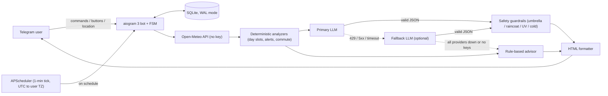

**English** | [Українська](README.uk.md)

# 🌦 Weather Wardrobe Bot

A personal Telegram bot that tells you **what to wear today**. On the days and times you choose, it sends a compact weather card, warns you about rain, wind and big temperature swings, analyzes your commute, and recommends an outfit, optionally from the clothes you actually own.

It is designed to run **24/7 for free** on Oracle Cloud Free Tier (Docker Compose, AMD64 and ARM64) and uses a hybrid **deterministic + LLM** architecture that keeps working even when the AI provider is down.

---

## ✨ Features

- **Compact, mobile-first UI**: three main buttons (`🌤 Today`, `📅 Tomorrow`, `⚙️ Settings`) and short, scannable messages.
- **Per-day schedule**: set a different send time for each weekday, or switch individual days off, all from inside the chat.
- **Commute analysis (`🚶 Route`)**: set a destination, weekdays, departure/return hours and transport mode (walk, bike, transit, car). The bot compares the weather at home and at the destination for the trip there, the day at the destination and the trip back. Cyclists get a raincoat recommendation instead of an umbrella, plus a lower wind threshold.
- **Smart location**: search by city, district or address (Open-Meteo geocoding with a Nominatim fallback) or send a Telegram location pin. The IANA timezone is detected automatically.
- **Personal thermal comfort**: an offset from `-5°C` to `+5°C`, tuned by the `🥶 Cold` / `👍 Ok` / `🥵 Warm` buttons under each forecast.
- **Your wardrobe + AI stylist**: describe your clothes in free text and the LLM picks from them (for example, no suede in the rain).
- **Free-text questions**: ask *"will I be cold in a windbreaker tonight?"* and get an answer grounded in the real forecast.
- **Private by design**: an optional `ALLOWED_USER_IDS` allow-list restricts who can use the bot.

---

## 🏗 Architecture



### Where AI helps, and where plain code is better

| Task | Approach | Why |
| --- | --- | --- |
| Timezones, scheduling, no duplicate sends | Plain code + SQLite | Must be exact and idempotent (`PRIMARY KEY` in `delivery_logs`). |
| Aggregating hourly weather, rain windows, wind, temperature swings, commute legs | Deterministic Python | LLMs should not do arithmetic or compare numbers. |
| Hard safety rules (umbrella / raincoat, UV, gloves in frost) | Deterministic guardrails | Even if the LLM forgets, `_enforce_safety_invariants` adds the item back. |
| Understanding a free-text wardrobe and choosing suitable items | LLM (JSON output) | Free text and material awareness are impractical to hand-code. |
| Answering free-form questions about the day | LLM | Natural-language answers on top of exact data. |
| Resilience | `Primary LLM → Fallback LLM → rule-based advisor` | The daily message is always delivered, even without any API key. |

---

## 🤖 Free LLM providers (optional)

The bot talks to any **OpenAI-compatible Chat Completions API** over plain `httpx`. With no API keys at all it runs in rule-based mode. Up to two providers can be chained (primary, then fallback).

| Provider | Notes | `.env` settings |
| --- | --- | --- |
| **Groq** (recommended primary) | Free tier, no credit card; limits are tracked per model | `LLM_BASE_URL=https://api.groq.com/openai/v1`<br>`LLM_MODEL=llama-3.3-70b-versatile` |
| **Cerebras** | Generous free daily token allowance | `LLM_FALLBACK_BASE_URL=https://api.cerebras.ai/v1`<br>`LLM_FALLBACK_MODEL=gpt-oss-120b` |
| **Google AI Studio (Gemini)** | Free tier; can be overloaded at peak times | `LLM_FALLBACK_BASE_URL=https://generativelanguage.googleapis.com/v1beta/openai/`<br>`LLM_FALLBACK_MODEL=<model id>` |
| **OpenRouter** (`:free` models) | Aggregator of free models | `LLM_FALLBACK_BASE_URL=https://openrouter.ai/api/v1` |
| **Ollama** (self-hosted) | No limits, runs locally | `LLM_BASE_URL=http://host.docker.internal:11434/v1`<br>`LLM_MODEL=llama3.2` |

Provider limits and model names change often, so check each provider's documentation. The weather data comes from **Open-Meteo**, which is free and needs no key.

---

## 🚀 Quick start (local)

Requires **Python 3.11+**. [`uv`](https://docs.astral.sh/uv/) is recommended.

```bash
git clone <your-repo-url> weather-wardrobe-bot
cd weather-wardrobe-bot

cp .env.example .env
# Set BOT_TOKEN (from @BotFather) and optionally LLM_API_KEY

uv sync --extra dev
uv run weather-bot
```

To keep the bot private, set `ALLOWED_USER_IDS=123456789,987654321` (get your ID from `@userinfobot`).

### Configuration

| Variable | Required | Description |
| --- | --- | --- |
| `BOT_TOKEN` | yes | Telegram bot token from `@BotFather`. |
| `ALLOWED_USER_IDS` | no | Comma-separated Telegram user IDs. Empty means anyone can use the bot. |
| `DB_PATH` | no | SQLite path (default `data/bot.db`; the Docker image uses `/app/data/bot.db`). |
| `LLM_API_KEY`, `LLM_BASE_URL`, `LLM_MODEL` | no | Primary LLM provider. |
| `LLM_FALLBACK_API_KEY`, `LLM_FALLBACK_BASE_URL`, `LLM_FALLBACK_MODEL` | no | Optional fallback LLM provider. |
| `LLM_TIMEOUT_SECONDS` | no | Per-request LLM timeout (default `15`). |
| `LOG_LEVEL` | no | `DEBUG`, `INFO`, `WARNING` or `ERROR`. |

---

## ☁️ Deploy on Oracle Cloud Free Tier (Docker Compose)

The image is built on `python:3.12-slim` and runs on both **AMD64** and **ARM64**. The bot uses long polling, so you do not need open inbound ports, a domain or TLS. SQLite lives in a named Docker volume (`bot_data`), so it survives rebuilds and works regardless of the host user's UID.

```bash
# On an Ubuntu VPS with Docker and the Compose plugin installed
git clone <your-repo-url> weather-wardrobe-bot
cd weather-wardrobe-bot

cp .env.example .env
nano .env              # fill in BOT_TOKEN (and optionally LLM_API_KEY, ALLOWED_USER_IDS)

docker compose up -d --build
docker compose logs -f
```

> On a 1 GB RAM instance (for example `VM.Standard.E2.1.Micro`), add a 1–2 GB swap file before building the image.

---

## 🔐 CI/CD and secrets handling

All secrets (`BOT_TOKEN`, API keys, `ALLOWED_USER_IDS`) live in a single `.env` file **on the server only**. `.env`, `*.pem`, `*.key` and SSH key patterns are git-ignored, and only `.env.example` is tracked.

The workflow in [`.github/workflows/ci.yml`](.github/workflows/ci.yml) runs on every push to `main`:

1. **`secret-scan`**: [Gitleaks](https://github.com/gitleaks/gitleaks) scans the repository history for leaked credentials.
2. **`lint-and-test`**: `ruff check src tests` and `pytest -v`.
3. **`deploy`**: runs only if the first two jobs pass. It connects to the server over SSH using a dedicated deploy key. On the server that key is restricted with an SSH **forced command** in `authorized_keys`:

   ```text
   command="/usr/local/bin/deploy-weather-bot.sh",restrict ssh-ed25519 AAAA... gh-actions-deploy
   ```

   so even a leaked deploy key can only trigger the fixed update script (`git reset --hard origin/main && docker compose up -d --build`). It cannot open a shell or read `.env`. The script uses `flock` so concurrent deploys never overlap.

If the deploy secrets are not configured, the deploy job is skipped and the pipeline stays green.

### Required GitHub Actions secrets

| Secret | Description |
| --- | --- |
| `ORACLE_HOST` | Public IP or hostname of the server. |
| `ORACLE_USER` | SSH user (usually `ubuntu`). |
| `ORACLE_SSH_KEY` | Private deploy key (restricted by the forced command above). |
| `ORACLE_PORT` | Optional, defaults to `22`. |

For a private repository, give the server a separate **read-only deploy key** (GitHub repository settings, *Deploy keys*, write access off) so it can `git fetch`.

---

## 🧪 Development

```bash
uv sync --extra dev
uv run ruff check src tests
uv run pytest -v
```

The test suite uses mocked HTTP (`httpx.MockTransport`) and covers the weather and commute analyzers, rule-based advice, LLM parsing, guardrails and failover, the SQLite repository, timezone-aware scheduling and HTML escaping.

---

## 📁 Project layout

```text
.
├── .github/workflows/ci.yml           # secret scan, lint, tests, deploy
├── .env.example                       # configuration template
├── Dockerfile                         # python:3.12-slim, non-root user
├── docker-compose.yml                 # service + bot_data volume
├── pyproject.toml                     # dependencies, pytest and ruff config
├── src/weather_wardrobe/
│   ├── config.py                      # pydantic settings, LLM provider chain
│   ├── models.py                      # domain models
│   ├── main.py                        # entry point, wiring, polling loop
│   ├── db/repository.py               # async SQLite (users, schedules, routes, deliveries)
│   ├── services/
│   │   ├── open_meteo.py              # weather, geocoding, Nominatim fallback
│   │   ├── weather_analyzer.py        # day slots and deterministic alerts
│   │   ├── route_analyzer.py          # commute analysis (there / at destination / back)
│   │   ├── rule_advisor.py            # standalone rule-based outfit advisor
│   │   ├── ai_advisor.py              # LLM advisor, guardrails, failover, Q&A
│   │   ├── formatter.py               # compact HTML messages
│   │   └── scheduler.py               # timezone-aware per-minute scheduler
│   └── bot/                           # keyboards, FSM states, middleware, handlers
└── tests/                             # pytest suite
```

---

## 📄 License

No license file is included yet. Add one (for example MIT) before sharing the code publicly.
