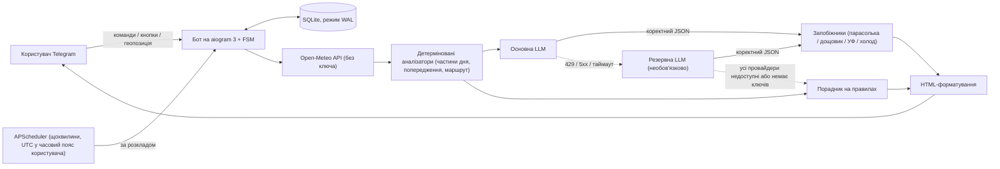

[English](README.md) | **Українська**

# 🌦 Weather Wardrobe Bot

Персональний Telegram-бот, який підказує, **що вдягнути сьогодні**. У вибрані вами дні та години він надсилає компактну картку з погодою, попереджає про дощ, вітер і різкі перепади температури, аналізує ваш маршрут і радить, як одягнутися, за бажанням із речей, які у вас справді є.

Бот розрахований на **цілодобову безкоштовну роботу** на Oracle Cloud Free Tier (Docker Compose, AMD64 та ARM64). Він використовує гібридну архітектуру **«детерміновані правила + LLM»**, тож працює навіть тоді, коли ШІ-провайдер недоступний.

---

## ✨ Можливості

- **Компактний інтерфейс для телефона**: три головні кнопки (`🌤 Сьогодні`, `📅 Завтра`, `⚙️ Налаштування`) і короткі повідомлення, які легко прочитати.
- **Розклад на кожен день**: окремий час надсилання для кожного дня тижня або вимкнення окремих днів, усе прямо в чаті.
- **Аналіз маршруту (`🚶 Маршрут`)**: задайте точку призначення, дні тижня, години виходу й повернення та спосіб пересування (пішки, велосипед, транспорт, авто). Бот порівнює погоду вдома і в точці призначення на дорогу туди, на день на місці та на дорогу назад. Велосипедистам при дощі він радить дощовик замість парасольки і враховує нижчий поріг вітру.
- **Розумний вибір локації**: пошук за назвою міста, району чи адресою (геокодинг Open-Meteo з резервним пошуком через Nominatim) або надсилання геопозиції в Telegram. Часовий пояс IANA визначається автоматично.
- **Особистий термокомфорт**: поправка від `-5°C` до `+5°C`, яку можна підлаштовувати кнопками `🥶 Холодно` / `👍 Ок` / `🥵 Спекотно` під кожним прогнозом.
- **Ваш гардероб + ШІ-стиліст**: опишіть свій одяг довільним текстом, і LLM підбиратиме речі саме з нього (наприклад, не порадить замшу в дощ).
- **Запитання довільним текстом**: напишіть *«чи не змерзну я ввечері у вітрівці?»* і отримайте відповідь на основі реального прогнозу.
- **Приватність**: необов'язковий список дозволених користувачів `ALLOWED_USER_IDS` обмежує, хто може користуватися ботом.

---

## 🏗 Архітектура



### Де допомагає ШІ, а де краще звичайний код

| Завдання | Підхід | Чому |
| --- | --- | --- |
| Часові пояси, розклад, захист від повторного надсилання | Звичайний код + SQLite | Має працювати точно та ідемпотентно (`PRIMARY KEY` у `delivery_logs`). |
| Агрегація погодинної погоди, проміжки дощу, вітер, перепади температури, ділянки маршруту | Детермінований Python | LLM не варто довіряти арифметику та порівняння чисел. |
| Жорсткі правила безпеки (парасолька / дощовик, УФ, рукавички в мороз) | Детерміновані запобіжники | Навіть якщо LLM забуде, `_enforce_safety_invariants` поверне потрібну річ. |
| Розуміння гардеробу, описаного довільним текстом, і вибір доречних речей | LLM (вивід у JSON) | Довільний текст і знання про матеріали складно описати вручну. |
| Відповіді на довільні запитання про день | LLM | Відповіді природною мовою поверх точних даних. |
| Стійкість до збоїв | `Основна LLM → Резервна LLM → порадник на правилах` | Щоденне повідомлення доставляється завжди, навіть без жодного API-ключа. |

---

## 🤖 Безкоштовні LLM-провайдери (необов'язково)

Бот працює з будь-яким **OpenAI-сумісним Chat Completions API** через звичайний `httpx`. Без API-ключів він працює в режимі правил. Можна об'єднати до двох провайдерів у ланцюжок (основний, потім резервний).

| Провайдер | Примітки | Налаштування в `.env` |
| --- | --- | --- |
| **Groq** (рекомендовано як основний) | Безкоштовний тариф без банківської картки; ліміти рахуються окремо для кожної моделі | `LLM_BASE_URL=https://api.groq.com/openai/v1`<br>`LLM_MODEL=llama-3.3-70b-versatile` |
| **Cerebras** | Щедрий безкоштовний щоденний ліміт токенів | `LLM_FALLBACK_BASE_URL=https://api.cerebras.ai/v1`<br>`LLM_FALLBACK_MODEL=gpt-oss-120b` |
| **Google AI Studio (Gemini)** | Безкоштовний тариф; у години пік можливе перевантаження | `LLM_FALLBACK_BASE_URL=https://generativelanguage.googleapis.com/v1beta/openai/`<br>`LLM_FALLBACK_MODEL=<id моделі>` |
| **OpenRouter** (моделі `:free`) | Агрегатор безкоштовних моделей | `LLM_FALLBACK_BASE_URL=https://openrouter.ai/api/v1` |
| **Ollama** (на власному сервері) | Без лімітів, працює локально | `LLM_BASE_URL=http://host.docker.internal:11434/v1`<br>`LLM_MODEL=llama3.2` |

Ліміти провайдерів і назви моделей часто змінюються, тож звіряйтеся з документацією кожного провайдера. Дані про погоду надає **Open-Meteo**: сервіс безкоштовний і не потребує ключа.

---

## 🚀 Швидкий старт (локально)

Потрібен **Python 3.11+**. Рекомендовано використовувати [`uv`](https://docs.astral.sh/uv/).

```bash
git clone <url-вашого-репозиторію> weather-wardrobe-bot
cd weather-wardrobe-bot

cp .env.example .env
# Вкажіть BOT_TOKEN (від @BotFather) і за бажанням LLM_API_KEY

uv sync --extra dev
uv run weather-bot
```

Щоб бот був приватним, задайте `ALLOWED_USER_IDS=123456789,987654321` (свій ID можна дізнатися в `@userinfobot`).

### Налаштування

| Змінна | Обов'язкова | Опис |
| --- | --- | --- |
| `BOT_TOKEN` | так | Токен Telegram-бота від `@BotFather`. |
| `ALLOWED_USER_IDS` | ні | ID користувачів Telegram через кому. Порожнє значення означає, що бот доступний усім. |
| `DB_PATH` | ні | Шлях до SQLite (за замовчуванням `data/bot.db`; у Docker-образі `/app/data/bot.db`). |
| `LLM_API_KEY`, `LLM_BASE_URL`, `LLM_MODEL` | ні | Основний LLM-провайдер. |
| `LLM_FALLBACK_API_KEY`, `LLM_FALLBACK_BASE_URL`, `LLM_FALLBACK_MODEL` | ні | Необов'язковий резервний LLM-провайдер. |
| `LLM_TIMEOUT_SECONDS` | ні | Таймаут одного запиту до LLM (за замовчуванням `15`). |
| `LOG_LEVEL` | ні | `DEBUG`, `INFO`, `WARNING` або `ERROR`. |

---

## ☁️ Розгортання на Oracle Cloud Free Tier (Docker Compose)

Образ збирається на базі `python:3.12-slim` і працює як на **AMD64**, так і на **ARM64**. Бот використовує long polling, тому не потрібні відкриті вхідні порти, домен чи TLS. SQLite зберігається в іменованому Docker-томі (`bot_data`), тож база переживає перезбирання і працює незалежно від UID користувача на хості.

```bash
# На Ubuntu VPS із встановленими Docker і плагіном Compose
git clone <url-вашого-репозиторію> weather-wardrobe-bot
cd weather-wardrobe-bot

cp .env.example .env
nano .env              # вкажіть BOT_TOKEN (і за бажанням LLM_API_KEY, ALLOWED_USER_IDS)

docker compose up -d --build
docker compose logs -f
```

> На інстансі з 1 ГБ RAM (наприклад, `VM.Standard.E2.1.Micro`) перед збиранням образу додайте swap-файл на 1–2 ГБ.

---

## 🔐 CI/CD і робота із секретами

Усі секрети (`BOT_TOKEN`, API-ключі, `ALLOWED_USER_IDS`) зберігаються в одному файлі `.env` **лише на сервері**. Файли `.env`, `*.pem`, `*.key` і шаблони SSH-ключів додано до `.gitignore`; у репозиторії відстежується тільки `.env.example`.

Workflow у [`.github/workflows/ci.yml`](.github/workflows/ci.yml) запускається на кожен push у `main`:

1. **`secret-scan`**: [Gitleaks](https://github.com/gitleaks/gitleaks) сканує історію репозиторію на витоки облікових даних.
2. **`lint-and-test`**: `ruff check src tests` і `pytest -v`.
3. **`deploy`**: запускається, лише якщо перші два кроки пройшли успішно. Підключається до сервера по SSH окремим deploy-ключем. На сервері цей ключ обмежено через SSH **forced command** в `authorized_keys`:

   ```text
   command="/usr/local/bin/deploy-weather-bot.sh",restrict ssh-ed25519 AAAA... gh-actions-deploy
   ```

   тож навіть у разі витоку deploy-ключ може лише запустити фіксований скрипт оновлення (`git reset --hard origin/main && docker compose up -d --build`). Він не може відкрити shell чи прочитати `.env`. Скрипт використовує `flock`, тому паралельні розгортання ніколи не перетинаються.

Якщо секрети для розгортання не налаштовано, крок deploy пропускається, а пайплайн лишається зеленим.

### Потрібні секрети GitHub Actions

| Секрет | Опис |
| --- | --- |
| `ORACLE_HOST` | Публічна IP-адреса або ім'я хоста сервера. |
| `ORACLE_USER` | Користувач SSH (зазвичай `ubuntu`). |
| `ORACLE_SSH_KEY` | Приватний deploy-ключ (обмежений forced command, описаним вище). |
| `ORACLE_PORT` | Необов'язково, за замовчуванням `22`. |

Для приватного репозиторію дайте серверу окремий **deploy-ключ лише для читання** (налаштування репозиторію на GitHub, *Deploy keys*, без права запису), щоб він міг виконувати `git fetch`.

---

## 🧪 Розробка

```bash
uv sync --extra dev
uv run ruff check src tests
uv run pytest -v
```

Тести використовують підмінений HTTP (`httpx.MockTransport`) і покривають аналізатори погоди та маршруту, поради на правилах, розбір відповідей LLM, запобіжники та перемикання між провайдерами, SQLite-репозиторій, планувальник із часовими поясами та екранування HTML.

---

## 📁 Структура проєкту

```text
.
├── .github/workflows/ci.yml           # сканування секретів, лінтер, тести, розгортання
├── .env.example                       # шаблон налаштувань
├── Dockerfile                         # python:3.12-slim, користувач без root
├── docker-compose.yml                 # сервіс + том bot_data
├── pyproject.toml                     # залежності, налаштування pytest і ruff
├── src/weather_wardrobe/
│   ├── config.py                      # налаштування pydantic, ланцюжок LLM-провайдерів
│   ├── models.py                      # доменні моделі
│   ├── main.py                        # точка входу, зв'язування компонентів, цикл polling
│   ├── db/repository.py               # асинхронний SQLite (користувачі, розклади, маршрути, доставки)
│   ├── services/
│   │   ├── open_meteo.py              # погода, геокодинг, резервний Nominatim
│   │   ├── weather_analyzer.py        # частини дня та детерміновані попередження
│   │   ├── route_analyzer.py          # аналіз маршруту (туди / на місці / назад)
│   │   ├── rule_advisor.py            # автономний порадник одягу на правилах
│   │   ├── ai_advisor.py              # LLM-порадник, запобіжники, резервування, відповіді на запитання
│   │   ├── formatter.py               # компактні HTML-повідомлення
│   │   └── scheduler.py               # щохвилинний планувальник із часовими поясами
│   └── bot/                           # клавіатури, стани FSM, middleware, обробники
└── tests/                             # набір тестів pytest
```

---

## 📄 Ліцензія

Файлу ліцензії поки немає. Додайте його (наприклад, MIT), перш ніж публічно ділитися кодом.
